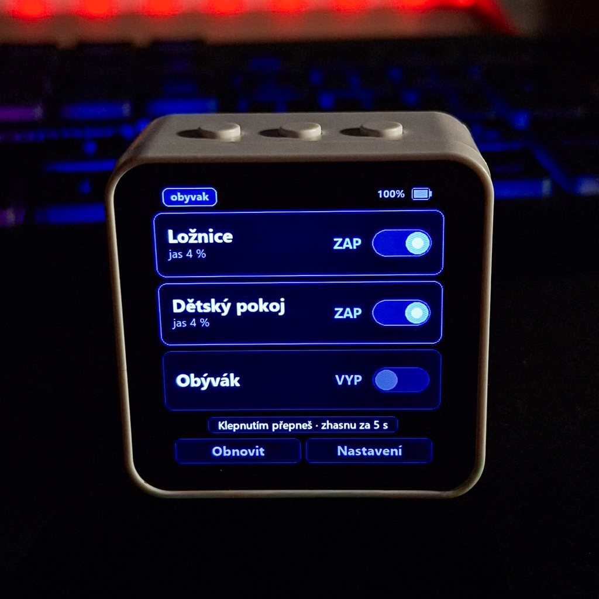
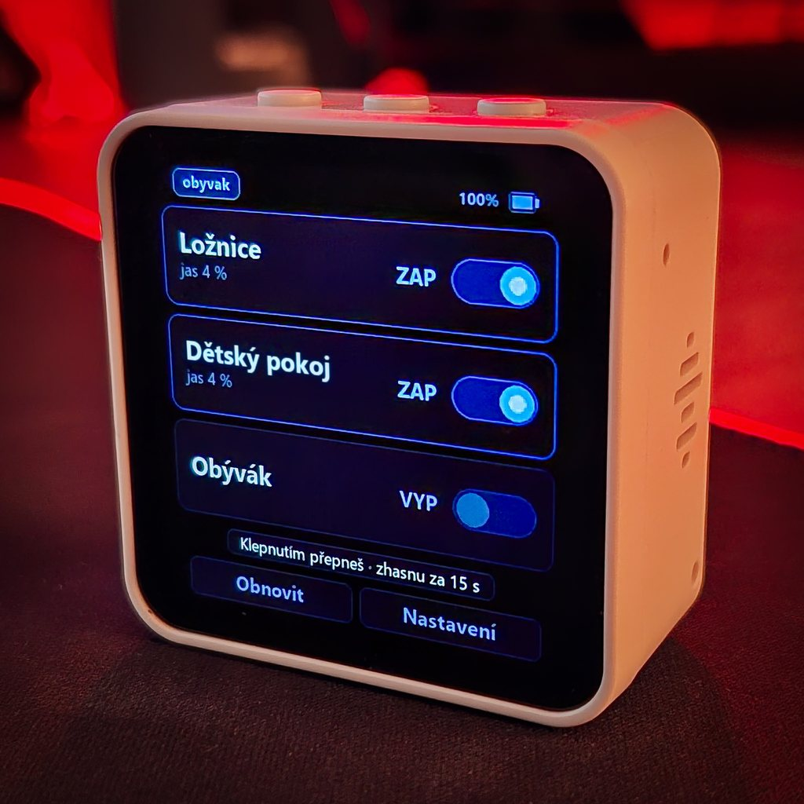
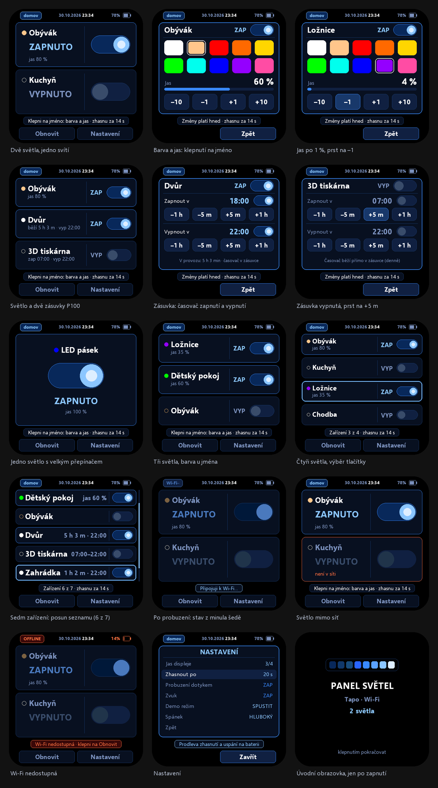
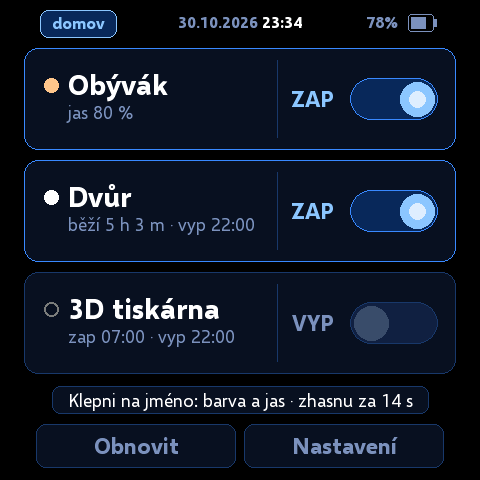
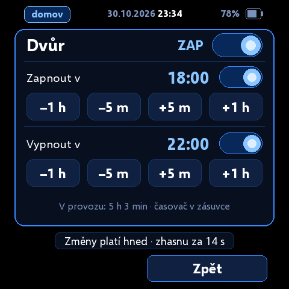
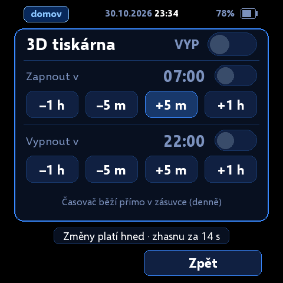

# Panel světel (Waveshare ESP32-S3-Touch-AMOLED-2.16)

Stolní ovladač pásků **Tapo L900** (a dalších světel Tapo) a chytrých zásuvek **Tapo P100** na baterii. Stejná krabička jako Rozhodovač: **2,16" dotykový AMOLED 480 × 480**, tři tlačítka, reproduktor, akumulátor. Firmware je jiný, krabička slouží jen světlům a zásuvkám: ukáže, zda svítí, klepnutím je přepne, světlům nastaví barvu a jas a zásuvkám denní časovač zapnutí a vypnutí.

> 🛒 Krabička: [Waveshare ESP32-S3-Touch-AMOLED-2.16 v RPishop](https://rpishop.cz/684624/waveshare-vyvojova-deska-esp32-s3-kapacitnim-amoled-2-16-displejem) (verze s baterií).

> 🌐 **Prezentační web a interaktivní simulátor:** otevři [`docs/index.html`](docs/index.html) v prohlížeči (nebo zapni GitHub Pages pro větev `main`, složku `/docs`). Simulátor kreslí obrazovky pixel po pixelu stejně jako firmware (stejná písma, barvy i primitiva) a napodobuje chování včetně barvy a jasu, časovače zásuvky, prodlevy, zhasnutí, spánku a ukázky.

<p align="center">
  <a href="docs/foto/20261030_224138.jpg"></a>
  &nbsp;
  <a href="docs/foto/20261030_224304.jpg"></a>
</p>

Fotky jsou ze starší verze firmwaru (bez data a času, barevné tečky a rozdělení karty); současný vzhled ukazuje přehled obrazovek níže.



Vzhled: černý podklad a odstíny modré (karty tmavě modré, zapnuté světlo světle modré, vypnuté šedomodré), oranžová jen pro chyby a slabou baterii. Skutečné barvy pásků ukazují jen tečky před jmény a dlaždice v nastavení barvy. Náhledy generuje `python tools/preview.py` do `docs/screens/`: kreslí ze stejných souřadnic, barev a dat písem (`src/smooth_font.cpp`) jako firmware, takže odpovídají displeji pixel po pixelu.

---

## Jak se chová

Krabička většinu času **spí**: displej zhasnutý, Wi-Fi vypnutá, procesor v hlubokém spánku. Baterii bere jen řadič napájení a čekání na dotyk či tlačítko.

1. **Dotyk displeje nebo tlačítko BOOT či KEY** krabičku probudí (PWR z hlubokého spánku nebudí). Displej se rozsvítí a hned ukáže poslední známý stav světel (šedě, ještě neověřený).
2. Krabička se připojí k Wi-Fi (po prvním připojení si pamatuje kanál i přístupový bod, další připojení trvá zlomek sekundy) a u každého světla zjistí, zda svítí.
3. Karty světel se rozsvítí: **ZAPNUTO** světle modře s přepínačem vpravo, **VYPNUTO** šedě. U zapnutého světla je i jas, tečka před jménem má barvu pásku (zhasnutý pásek = kroužek).
4. **Klepnutím na pravou část karty** (stav a přepínač za svislou čarou) se světlo přepne. Krabička povel odešle, stav znovu ověří a cvakne. **Klepnutím na jméno** (levá část karty) se otevře [barva a jas](#barva-a-jas).
5. Po prodlevě bez dotyku (výchozí **20 s**, odpočet je dole na displeji) displej zhasne, Wi-Fi se vypne a krabička usne; posledních 5 s před tím je displej ztlumený. Prst ani stisk, který ji probudil, se nepočítá jako povel: první dotyk budí, teprve druhý ovládá. Před usnutím krabička počká, až je prst ze skla pryč a tlačítka puštěná (budicí piny reagují na úroveň).

Na **USB** krabička neusíná, jen zhasne a čeká (prodleva trojnásobná, nejméně minuta). Probuzení je pak okamžité a budí cokoli: dotyk (i s vypnutým probuzením dotykem), BOOT, KEY i PWR. Když kabel odpojíš během čekání, krabička usne jako na baterii.

Komunikace jde **přímo v místní síti** protokolem KLAP, stejným jako používá aplikace Tapo. Cloud TP-Link se nepoužívá, internet není potřeba.

---

## Co umí

- Až **12 světel a zásuvek** (na obrazovce nejvýš **5 karet najednou**): jedno = velký přepínač, dvě = dvě karty, tři a čtyři = řádky se stavem ZAP/VYP vedle přepínače, pět = řádky bez textu ZAP/VYP (stav ukazuje přepínač), velké jméno a vedle něj jas, doba provozu nebo chyba. Při více než 5 zařízeních zůstává velikost karet stejná jako pro 5 zařízení, seznam se při pohybu kurzoru (nebo tažením prstem) posouvá, na konci skočí zpět nahoru a ve stavovém řádku dole ukazuje, na kolikátém zařízení z kolika je kurzor (`Zařízení 6 z 7`).
- **Jméno světla** z aplikace Tapo (nebo vlastní popisek ze `secrets.h`), stav, jas a barva (tečka před jménem). Jméno, které se nevejde, se zkrátí a dostane „…“.
- **Barva a jas** každého světla: klepnutí na jméno otevře obrazovku s deseti základními barvami a jasem po 10 % nebo po 1 % (1 až 100 %). Změna se pošle hned a zhasnutý pásek rozsvítí, podrobně v části [Barva a jas](#barva-a-jas).
- **Zásuvky Tapo P100** (3D tiskárna, osvětlení dvora apod.) vedle světel: krabička pozná zásuvku sama (nehlásí jas ani barvu), na kartě ukáže dobu provozu (`běží 5 h 4 m`) a případný časovač a klepnutí na jméno otevře místo barev a jasu [časovač zapnutí a vypnutí](#zásuvky-tapo-p100). Časovač běží přímo v zásuvce, takže funguje i když krabička spí.
- **Poslední známý stav** se ukáže ihned po probuzení, ověřený stav ho nahradí během sekundy či dvou. Po úplném vypnutí ho krabička nezná (RTC paměť vypnutí nepřežije), do načtení ukazuje „…“.
- **Klepnutí během připojování** se zapamatuje a provede, jakmile je stav načtený (stejně změna barvy nebo jasu). Klepnutí během čekání na odpověď pásku se řadí do fronty a vyřídí hned po ní.
- Chyby přímo na kartě (oranžový rámeček a hláška místo jasu): `není v síti`, `neodpovídá`, `špatné přihlášení`, `relace vypršela`, `chyba protokolu`, `chyba HTTP`, `zařízení zaneprázdněno`, u zásuvky `stejný čas zap i vyp`.
- **Datum a čas** v horní liště mezi Wi-Fi a baterií (například 30.10.2026 23:34; když se nevejde, jen čas). Po připojení se čas nastaví ze sítě (NTP, pásmo Praha včetně letního času) a uloží do hardwarových hodin PCF85063, které běží i ve spánku, takže po probuzení platí hned. Dokud čas není nastavený, hodiny se neukazují.
- **Relace KLAP přežije spánek** (RTC paměť), takže po probuzení obvykle odpadá handshake. Platí podle cookie z pásku s rezervou 20 minut, nejdéle 20 hodin.
- Nastavení v krabičce: jas, prodleva zhasnutí, probuzení dotykem, zvuk, demo režim, způsob spánku.
- Zakrytí displeje dlaní = okamžité zhasnutí a uspání.
- **Vyhlazené písmo**: Selawik (otevřená náhrada Segoe UI od Microsoftu, licence OFL) se 4bitovou průhledností hran a českou diakritikou (velikosti 32, 28, 24, 22, 19, 18, 16 a 12 px), předem převedené do bitmap v `src/smooth_font.cpp`.
- **Stavová pilulka** nad tlačítky: odpočet do zhasnutí s nápovědou, průběh připojení, chyba Wi-Fi, v nastavení popis vybrané položky.
- **Demo režim** v nastavení: 12 ukázek všech podob obrazovky (1 až 6 světel, výběr tlačítky, barva a jas, světlo a zásuvky P100, časovač zásuvky, stav z minula, světlo mimo síť, výpadek Wi-Fi a slabá baterie), kreslených stejným kódem jako skutečná světla. Světla se během ukázky neovládají.

---

## Požadavky

- Krabička Waveshare ESP32-S3-Touch-AMOLED-2.16 s baterií.
- Zásuvky Tapo P100 (SMART.TAPOPLUG, ověřeno na firmwaru 1.4.6 a 1.5.5) používají stejný protokol KLAP a stejný účet jako pásky, nic navíc se nenastavuje.
- Pásek Tapo L900 (nebo jiné světlo Tapo rodiny SMART.TAPOBULB) s aktuálním firmwarem (cíleno na 1.4.3 s protokolem KLAP; starý protokol „securePassthrough“ z roku 2022 není podporován).
- V aplikaci Tapo zapnutá **Kompatibilita s třetími stranami** (Já → Nastavení → Kompatibilita s třetími stranami). Bez ní pásek s novým firmwarem místní přihlášení odmítne (`špatné přihlášení`).
- Pásek i krabička ve stejné síti (stejný rozsah adres, bez izolace klientů na Wi-Fi).
- Windows s PowerShellem, Python 3.10+ a PlatformIO:

```powershell
python -m pip install platformio
```

Firmware potřebuje Arduino core 3.x, `platformio.ini` proto fixuje platformu `espressif32 @ ~8.0.0` (ověřeno s 8.0.0 a Arduino core 3.3.12). První build stáhne toolchain ESP32 (stovky MB).

---

## 1. Nastavení (`include/secrets.h`)

```powershell
Copy-Item include\secrets.example.h include\secrets.h
```

Do `include/secrets.h` (je v `.gitignore`) vyplň:

| Položka | Význam |
|---|---|
| `WIFI_NETS` | Seznam Wi-Fi sítí (SSID, heslo), může jich být víc. Viz Wi-Fi níže. |
| `TAPO_USER`, `TAPO_PASS` | E-mail a heslo účtu Tapo, stejné jako v aplikaci. Jeden účet pro všechna světla, pásek z něj počítá přihlašovací hash. |
| `TAPO_AUTH_HASH` | Volitelně místo hesla: hash z `python tools/tapo_hash.py EMAIL`. Když není prázdný, má přednost a firmware heslo neobsahuje. |
| `TAPO_DEVICES` | Světla a zásuvky, nejvýš 12 (na displeji po 5): popisek a adresa. Viz Světla níže. |
| `PANEL_STATIC_IP` (+ `PANEL_GATEWAY`, `PANEL_SUBNET`, `PANEL_DNS`) | Volitelná pevná adresa krabičky; bez DHCP je probuzení rychlejší. Platí pro všechny sítě ze seznamu, při sítích s různými rozsahy adres ji nech prázdnou. |

```cpp
static const WifiNet WIFI_NETS[] = {
  { "domov",   "heslo" },        // zkouší se první
  { "obyvak",  "heslo" },        // pak další v pořadí
};

static const TapoDev TAPO_DEVICES[] = {
  { "Obývák",       "192.168.1.57" },  // popisek na displeji, IP adresa
  { "Dětský pokoj", "192.168.1.60" },  // pořadí = pořadí karet
  { "3D tiskárna",  "192.168.1.61" },  // zásuvka P100: stejný zápis jako světlo
};
```

**Wi-Fi.** Pořadí sítí v seznamu je priorita. Kanál a přístupový bod úspěšné sítě si krabička pamatuje v RTC paměti a po probuzení se k ní připojí bez skenování (zlomek sekundy). Když to nevyjde (krabička je jinde nebo router změnil kanál), jednou prohledá okolí (asi 1,5 s) a připojí se rovnou k první síti ze seznamu, kterou vidí; u sítě s víc přístupovými body k nejsilnějšímu. Sítě, které sken nenašel (třeba se skrytým SSID), zkusí nakonec podle jména. Na celé připojení má 12 s, potom hlásí `Wi-Fi nedostupná`. Krabička umí jen pásmo 2,4 GHz.

**Světla.** Pořadí v `TAPO_DEVICES` je pořadí karet na displeji. Když popisek necháš prázdný, krabička ukáže jméno světla z aplikace Tapo. Adresa je IP adresa pásku (aplikace Tapo → zařízení → Nastavení zařízení → Info o zařízení), jde zadat i jméno v síti, které se přeloží přes DNS. **V routeru adresy rezervuj** podle MAC adresy, jinak se po čase změní a krabička hlásí `není v síti`. Světla musí být dosažitelná ze sítě, ke které se krabička připojí.

Údaje jsou zakompilované do firmwaru: po každé změně `secrets.h` je potřeba firmware znovu nahrát (`.\flash.ps1`).

### Ověření z počítače (nepovinné)

Než se nahraje firmware, jde přihlášení k pásku vyzkoušet z PC ve stejné síti knihovnou python-kasa:

```powershell
python -m pip install python-kasa
kasa --host 192.168.1.57 --username EMAIL --password HESLO --device-family SMART.TAPOBULB --encrypt-type KLAP --login-version 2 state
```

Když tohle projde, projde i krabička.

---

## 2. Nahrání firmwaru

Připoj krabičku datovým USB-C kabelem a spusť:

```powershell
.\flash.ps1
```

Skript zkompiluje firmware a nahraje ho. Další parametry:

| Parametr | Význam |
|---|---|
| `-Monitor` | po nahrání otevře sériový výpis (115200 Bd) |
| `-Port COM8` | vynutí port |
| `-EraseFirst` | před nahráním smaže celou flash včetně nastavení |
| `-BuildOnly` | jen kompilace |

PlatformIO skript hledá v tomto pořadí: proměnná `PANEL_PIO` (cesta k `pio.exe`), `pio` v PATH, `%USERPROFILE%\.platformio\penv\Scripts\pio.exe`, `python -m platformio` (nejdřív Python 3.12 v `%LOCALAPPDATA%\Programs\Python`, pak `python` z PATH).

Když vedle leží repozitář Rozhodovače (`..\rozhodovac`), skript na dobu nahrávání zastaví jeho most (`bridge\rozhodovac_ctl.py`), aby uvolnil sériový port, a potom ho zase spustí.

Po nahrání krabička na 5 s ukáže úvodní obrazovku (jen po zapnutí, ne po probuzení; klepnutí nebo tlačítko ji zkrátí), připojí se a načte stav světel.

---

## Ovládání

| Ovladač | Hlavní obrazovka | Nastavení |
|---|---|---|
| **klepnutí na přepínač** (pravá část karty) | přepne světlo | klepnutí na položku ji změní |
| **klepnutí na jméno** (levá část karty) | otevře barvu a jas (u zásuvky [časovač](#zásuvky-tapo-p100)) | |
| **podržení prstu** | otevře nastavení | zavře |
| **Obnovit** (dole vlevo) | znovu načte stav (při výpadku Wi-Fi nové připojení) | není zobrazeno |
| **Nastavení / Zavřít** (dole vpravo) | otevře nastavení | zavře |
| **BOOT** krátce | posun dolů: první stisk označí první zařízení (modrý rámeček), další posunou výběr (při více než 5 zařízeních posouvá seznam a na konci skočí nahoru); u jediného zařízení obnoví stav | další položka |
| **BOOT** podržení | nastavení | zavře |
| **KEY** | akce: přepne vybrané světlo | změní položku |
| **PWR** krátce | hned zhasnout a usnout | |
| **PWR** 6 s | úplné vypnutí (hardware AXP2101), zapnutí podržením 0,5 s | |
| **zakrytí dlaní** | hned zhasnout a usnout | |

Prst nebo tlačítko, které krabičku probudilo, se jako povel nepočítá: první dotyk budí, teprve další ovládá.

V **ukázce** (Demo režim) klepnutí kamkoli nebo krátký stisk BOOT přejde na další obrazovku (samy se střídají po 3,5 s). Konec: tlačítko Ukončit, KEY, podržení prstu nebo podržení BOOT.

### Barva a jas

Klepnutí na jméno světla otevře přes celou plochu jeho nastavení:

| Ovladač | Akce |
|---|---|
| **přepínač** nahoře vpravo nebo **KEY** | zapne / vypne světlo |
| **barevná dlaždice** | základní barva: bílá, teplá bílá, červená, oranžová, žlutá, zelená, tyrkysová, modrá, fialová, růžová; aktuální má bílý rámeček |
| **–10 / –1 / +1 / +10** | jas po desítkách nebo po jednom procentu, 1 až 100 % |
| **Zpět** (dole vpravo) nebo **BOOT** | zpět na světla |
| **podržení prstu** | jako pomalé klepnutí na prvek pod prstem |

Změna se projeví hned: číslo na displeji se přepíše okamžitě a pásek dostane jeden požadavek `set_device_info`. Když ťukáš rychle za sebou, pásek dostane až poslední hodnotu. Změna barvy nebo jasu zhasnutý pásek rozsvítí; když se nic nemění (stejná barva nebo jas u svítícího pásku), nic se neposílá. Barva nastavená v aplikaci Tapo, která neodpovídá žádné dlaždici, je vidět jen na tečce před jménem. Světlo, které barvu nehlásí (bílá žárovka), má místo dlaždic jen jas.

### Zásuvky Tapo P100

Krabička ovládá i chytré zásuvky Tapo P100 (SMART.TAPOPLUG), například na 3D tiskárnu nebo osvětlení dvora. Zásuvka se zapíše do `TAPO_DEVICES` stejně jako světlo (popisek a IP adresa), používá stejný účet Tapo a stejný protokol KLAP. Krabička ji pozná sama podle toho, že nehlásí jas, a změní podle toho vzhled i chování:

- **Karta** nemá jas ani barevnou tečku (tečka je bílá). Pod jménem je **doba provozu** zásuvky od posledního zapnutí (`běží 5 h 3 m`) a nejbližší automatické vypnutí (`běží 5 h 3 m · vyp 22:00`). Vypnutá zásuvka s povoleným časovačem ukáže plán (`zap 07:00 · vyp 22:00`, jen jedno z nich `zap v 07:00` / `vyp v 22:00`). Při pěti a šesti kartách je popis vedle jména a zkrácený: `5 h 3 m · 22:00` (bez „běží“, když je naplánované vypnutí) a `07:00–22:00`.
- **Klepnutí na přepínač** (pravá část karty) nebo **KEY** zásuvku zapne či vypne hned. Chyby (`není v síti`, `neodpovídá`…) se ukazují stejně jako u světel.
- **Klepnutí na jméno** (levá část karty) místo barev a jasu otevře **časovač**.



#### Detail: časovač zapnutí a vypnutí

Detail je rozdělený na dva řádky, **Zapnout v** a **Vypnout v**. Každý má čas `HH:MM`, přepínač, který pravidlo povolí nebo zakáže (čas zůstane uložený), a čtyři tlačítka pro posun času.

| Ovladač | Akce |
|---|---|
| **přepínač** nahoře vpravo nebo **KEY** | zapne / vypne zásuvku hned (nezávisle na časovači) |
| **Zapnout v** `HH:MM` + přepínač | denní automatické zapnutí; přepínač pravidlo povolí nebo zakáže |
| **Vypnout v** `HH:MM` + přepínač | denní automatické vypnutí |
| **–1 h / –5 m / +5 m / +1 h** | posun času pod příslušným řádkem; posun pravidlo zároveň povolí |
| **Zpět** (dole vpravo) nebo **BOOT** | zpět na karty |
| **podržení prstu** | jako pomalé klepnutí na prvek pod prstem |



Tlačítka **±5 m** posouvají po pěti minutách: když je čas mezi nimi (například 18:07 z aplikace Tapo), první stisk ho zaokrouhlí na nejbližší pětiminutovku v daném směru, další posouvají po 5 minutách. Čas přeskakuje přes půlnoc (23:55 + 5 m = 00:00).



**Jak časovač funguje**

- Pravidla se ukládají **přímo do paměti zásuvky** (`add_schedule_rule` / `edit_schedule_rule`, opakování každý den v týdnu). Zásuvka je pak spíná sama, i když krabička spí, je vypnutá nebo mimo dosah, a bez cloudu TP-Link.
- Zásuvka podporuje víc pravidel; krabička pracuje s **jedním pravidlem zapnutí a jedním vypnutí**. Když už v zásuvce nějaká pravidla jsou (třeba z aplikace Tapo), krabička si při prvním načtení přečte první pravidlo zapnutí a první pravidlo vypnutí a ty upravuje. Když pravidlo chybí, při první změně se založí. Ostatní pravidla zůstávají nedotčená.
- Zapnutí a vypnutí **nesmí mít stejný čas** (na minutu přesně): zásuvka to odmítne chybou `-1803` („stejný čas zap i vyp“). Posun času proto takovou minutu přeskočí; kdybys ji přesto nastavil jinak (třeba v aplikaci), zásuvka změnu nepřijme.
- Úprava se na displeji ukáže hned a zásuvce se pošle vzápětí. Když ťukáš rychle za sebou (třeba posun o hodinu), odešle se až poslední hodnota. Povel nezmění, zda zásuvka právě svítí: zapnutí/vypnutí v daný čas je jen plán.
- Pravidla založená v aplikaci s časem podle východu či západu slunce krabička při změně přepíše na pevný čas. Stejně tak pravidlo jen pro některé dny v týdnu: po změně z krabičky platí každý den.
- Časovač se čte při každém načtení stavu (po probuzení i tlačítkem Obnovit), takže změny z aplikace Tapo krabička uvidí. Když se pravidla přečíst nepodaří, karta ukazuje poslední známé časy a změna z detailu se neodešle (ukáže se chyba), aby se v zásuvce nezaložilo pravidlo navíc.
- Čas „teď“ si bere zásuvka od sebe (nastavuje se z internetu přes aplikaci Tapo). Když zásuvka po restartu nemá přístup k internetu, nemusí znát správný čas a časovač nespustí; proto jí nech sítě povolený internet.
- Pozor u zásuvek, kde vypnutí něco zničí: u 3D tiskárny nenastavuj vypnutí na dobu, kdy se může tisknout.

**Ověřeno** na dvou skutečných zásuvkách P100 (hardware 1.20 s firmwarem 1.5.5 a hardware 2.0 s firmwarem 1.4.6): přihlášení KLAP, čtení stavu a doby provozu, čtení, přidání i úprava pravidla. Odstranění pravidla (`remove_schedule_rules`) zásuvka s našimi parametry odmítla (`-1008`), proto firmware pravidla nemaže, jen je zakáže. Když úprava pravidla selže, krabička si seznam pravidel přečte znovu a nové založí jen tehdy, když původní pravidlo v zásuvce opravdu chybí (někdo ho smazal v aplikaci); jinak ukáže chybu a nic nezakládá.

**V simulátoru a v ukázce.** Webový simulátor (část Simulátor na [panel.zkusmo.cz](https://panel.zkusmo.cz)) má ve výchozích dvou zařízeních jednu zásuvku (LED dvůr), takže časovač jde vyzkoušet klepnutím na její jméno; při čtyřech a více zařízeních přibude druhá (3D tiskárna). Demo režim v krabičce má dvě nové obrazovky: *Světlo a zásuvky P100* a *Zásuvka: časovač zap/vyp*.

Pásek L900 nemá bílé diody ani nastavení teploty bílé: bílá je složená z červené, zelené a modré (sytost 0, vychází spíš studená) a teplá bílá je jen nádech do oranžova (odstín 30°, sytost 45 %). Odstín a sytost základních barev jsou v `COLOR_PRESETS` v `src/main.cpp` (stejný seznam mají `tools/preview.py` a `docs/simulator.js`).

### Nastavení

| Položka | Hodnoty | Poznámka |
|---|---|---|
| Jas displeje | 0/4 až 4/4 | výchozí 3/4, nižší jas prodlouží výdrž |
| Zhasnout po | 10 / 20 / 30 / 60 / 120 s | prodleva na baterii; na USB trojnásobek, nejméně 60 s |
| Probuzení dotykem | ZAP / VYP | VYP = ze spánku budí jen tlačítka BOOT a KEY; řadič dotyku se před spánkem uspí a baterie vydrží déle. Na USB budí dotyk vždy. |
| Zvuk | ZAP / VYP | cvaknutí při ovládání, dvojtón při zapnutí/vypnutí světla, dvojí hluboké pípnutí při chybě |
| Demo režim | SPUSTIT | ukázka 12 podob obrazovky, viz výše; během ní se světla neovládají |
| Spánek | HLUBOKÝ / VYPNOUT | VYPNOUT = po prodlevě úplné vypnutí přes AXP2101; zapne jen podržení PWR (0,5 s), zato spotřeba je nejnižší možná. Na USB krabička jen zhasne. |
| Zpět | | klepnutím zavře nastavení |

V nastavení ukazuje stavová pilulka nad tlačítky popis právě vybrané položky. Nastavení se ukládá do NVS a přežije i přehrání firmwaru (`-EraseFirst` ho smaže).

---

## Spotřeba a spánek

- **Hluboký spánek** (výchozí): procesor stojí, displej je vypnutý (`displayOff`), Wi-Fi vypnutá. Probuzení zajišťuje blok RTC přes piny BOOT (GPIO 0), KEY (GPIO 18) a INT dotyku (GPIO 11). PWR mezi nimi není, krátký stisk se čte z AXP2101 jen za běhu. Probuzení = nový start firmwaru, úvodní obrazovka se přeskočí a poslední stav světel i relace KLAP se vezmou z RTC paměti.
- **Probuzení dotykem** nechává řadič dotyku CST9220 bdít (ten sám přejde do úsporného režimu a při dotyku stáhne INT k nule). Pin INT drží vnitřní pull-up, proto ve spánku zůstává zapnutá i doména RTC periferií (pár µA navíc). S vypnutým probuzením dotykem se řadič před spánkem uspí příkazem a budí jen tlačítka, která mají pull-upy na desce.
- **Na USB** se krabička neuspává, aby byla hned k dispozici; jen zhasne displej a vypne Wi-Fi.
- **Vybitá baterie** (bez USB nejvýš 2 % a zároveň pod 3,35 V; procenta z měřiče AXP2101 samotná nemusí být spolehlivá): krabička ukáže hlášku a vypne se, aby se článek nepoškodil.
- **Během bdění** se šetří, kde to není znát: procesor běží na 160 MHz místo 240 MHz. Wi-Fi jede naplno jen při připojování a při komunikaci s pásky; po načtení stavu přejde do úsporného režimu (modem sleep, rádio mezi majáky přístupového bodu spí) a před každým přepnutím nebo změnou barvy či jasu se na tu chvíli zase probudí, takže odezva pásku se neprodlouží. Posledních 5 s před zhasnutím je displej ztlumený na čtvrtinu jasu; dotyk ho hned vrátí. Výdrž dál nejvíc ovlivní jas displeje a prodleva zhasnutí.
- **Před hlubokým spánkem** se vypne analogová část zvukového kodeku ES8311 (po probuzení se nastaví znovu) a měření AXP2101, která ve spánku nikdo nečte (teplota, napětí USB a systému; napětí baterie zůstává kvůli měřiči nabití). Nepoužívaný akcelerometr QMI8658 se vypíná hned při startu.
- Větve napájení periferií (ALDO1 zvuk, ALDO2 periferie) zůstávají ve spánku zapnuté. Vypnutí zvukové větve před spánkem je k vyzkoušení přes `-DPANEL_SLEEP_AUDIO_RAIL_OFF=1` v `platformio.ini`; kdyby po něm nefungovalo probuzení dotykem, vrať 0. Zvuk jde vypnout úplně `-DPANEL_AUDIO=0` (kodek se pak ani neinicializuje).

---

## Řešení potíží

| Co krabička hlásí | Příčina | Řešení |
|---|---|---|
| `Wi-Fi nedostupná` | špatné SSID/heslo, síť mimo dosah, jiné pásmo než 2,4 GHz | zkontroluj `WIFI_NETS`; krabička umí jen 2,4 GHz |
| `není v síti` | pásek má jinou IP, je vypnutý ze zásuvky, nebo je v jiné síti/VLAN | ověř IP v aplikaci Tapo, rezervuj ji v routeru |
| `neodpovídá` | pásek je přetížený nebo síť ztrácí pakety | klepni na Obnovit; zkus pásek odpojit a zapojit |
| `špatné přihlášení` | jiný účet než v aplikaci, překlep, nebo vypnutá Kompatibilita s třetími stranami | oprav `TAPO_USER`/`TAPO_PASS`, zapni kompatibilitu v aplikaci Tapo |
| `relace vypršela` | pásek zahodil relaci (restart) | krabička zkouší nový handshake sama; při opakování klepni na Obnovit |
| `chyba protokolu` | pásek odpovídá jinak, než se čeká (starý firmware se securePassthrough, nebo není Tapo) | aktualizuj firmware pásku v aplikaci |
| `chyba HTTP` | na adrese běží něco jiného než Tapo | zkontroluj IP |
| `zařízení zaneprázdněno` | pásek nebo zásuvka povel teď nepřijme | chvíli počkej a zkus znovu |
| `stejný čas zap i vyp` | zapnutí i vypnutí zásuvky na stejnou minutu (třeba nastavené v aplikaci Tapo) | posuň jeden z časů |
| časovač zásuvky nespíná | pravidlo je zakázané, nebo zásuvka nezná správný čas (po restartu bez internetu) | v detailu zásuvky zkontroluj přepínač pravidla; nech zásuvce přístup k internetu |
| krabička se nebudí dotykem | probuzení dotykem vypnuté, nebo řadič dotyku po vypnutí větve nejede | zkontroluj nastavení; `PANEL_SLEEP_AUDIO_RAIL_OFF` nech 0; BOOT a KEY budí vždy |
| krabička se nebudí vůbec | režim Spánek = VYPNOUT, nebo vybitá baterie | podrž PWR 0,5 s; připoj USB |

Sériový výpis (`.\flash.ps1 -Monitor`) ukazuje důvod startu (`wake=0` zapnutí, `1` tlačítko, `2` dotyk), průběh připojení a návratové kódy KLAP.

---

## Architektura

```
panel/
├── platformio.ini         deska, Arduino core 3.x, přepínače PANEL_AUDIO, PANEL_SLEEP_AUDIO_RAIL_OFF
├── partitions.csv         rozdělení flash (stejné jako Rozhodovač)
├── flash.ps1              kompilace + nahrání
├── include/
│   ├── pin_config.h       piny krabičky (displej, I2C, dotyk, tlačítka, zvuk)
│   ├── secrets.example.h  šablona přihlašovacích údajů
│   └── secrets.h          (ignorováno gitem) tvoje Wi-Fi, účet Tapo, světla
├── src/
│   ├── main.cpp           stavový automat (Wi-Fi → načtení → ovládání → spánek), obrazovky, barva a jas, časovač zásuvky,
│   │                      ukázka, dotyk, tlačítka
│   ├── hw_waveshare.*     hardware z Rozhodovače: AMOLED CO5300 + plátno v PSRAM, dotyk CST9220,
│   │                      AXP2101, tlačítka, zvuk, hodiny PCF85063; navíc hluboký spánek a důvod probuzení
│   ├── smooth_font.*      vyhlazená písma (bitmapy se 4bitovou průhledností) a jejich kreslení
│   ├── es8311.*           ovladač kodeku (zvuk)
│   ├── net.*              Wi-Fi bez blokování smyčky: rychlé připojení z RTC paměti (kanál + BSSID), jinak jeden sken
│   │                      a první viditelná síť ze seznamu; čas ze sítě (NTP)
│   ├── tapo_klap.*        protokol KLAP: handshake, AES-CBC, podpisy, HTTP po TCP, relace v RTC paměti
│   ├── tapo_device.*      get_device_info / set_device_info (zapnuto, jas, barva, jméno, doba provozu zásuvky)
│   │                      a pravidla časovače zásuvky (get/add/edit_schedule_rule)
│   └── settings.h         nastavení v NVS
├── lib/                   GFX Library for Arduino (bez CJK fontů), SensorLib (bez Bosch), XPowersLib
├── docs/
│   ├── index.html         prezentační web (GitHub Pages: větev main, složka /docs)
│   ├── style.css          vzhled webu
│   ├── simulator.js       simulátor displeje: framebuffer RGB565, stejné kreslení i chování jako main.cpp
│   ├── smooth_font.js     písma pro simulátor (výstup tools/preview.py ze src/smooth_font.cpp)
│   ├── gallery.js         lightbox: obrazovky jen na celý násobek (ostré pixely), fotky plynule do okna
│   ├── screens/           obrazovky 480 px (výstup tools/preview.py), thumbs/ = přesné poloviny 240 px pro web
│   └── foto/              fotky krabičky 2048 px bez metadat (EXIF, GPS), thumbs/ = 1024 px pro web a README
└── tools/
    ├── tapo_hash.py       hash účtu Tapo pro secrets.h
    ├── gen_smooth_fonts.py  převod písma Selawik (tools/fonts) do src/smooth_font.*
    ├── fonts/             písmo Selawik a jeho licence OFL
    └── preview.py         náhledy obrazovek bez hardwaru (Pillow) a písma pro simulátor
```

Rozvržení obrazovek je ve třech kopiích, které musí souhlasit: `src/main.cpp` (firmware), `tools/preview.py` (náhledy) a `docs/simulator.js` (web). Po změně písem (`python tools/gen_smooth_fonts.py`) nebo rozvržení spusť `python tools/preview.py`, přegeneruje náhledy i `docs/smooth_font.js`.

Novou fotku pro web dej do `docs/foto/` bez metadat (telefon do JPEG ukládá i GPS polohu) a zmenšeninu 1024 × 1024 px do `docs/foto/thumbs/`.

Hlavní smyčka nekreslí pořád: obrazovka se překreslí jen při změně (dotyk, nový stav, každá sekunda odpočtu). Síťové operace běží v hlavní smyčce blokovaně (čtení stavu jednoho pásku trvá stovky ms), proto se před nimi karta překreslí jako „zjišťuji“. Klepnutí během čekání se zachytí a vyřídí hned potom.

### Protokol KLAP ve zkratce

Podle `KlapTransportV2` z python-kasa:

1. `auth = sha256(sha1(e-mail) + sha1(heslo))`
2. `POST /app/handshake1` s 16 náhodnými bajty (`local`), odpověď `remote` (16 B) + `sha256(local + remote + auth)`; neshoda = špatné přihlášení. Z hlavičky `Set-Cookie` se vezme `TP_SESSIONID`.
3. `POST /app/handshake2` se `sha256(remote + local + auth)`.
4. Klíč `sha256("lsk"+…)[:16]`, IV `sha256("iv"+…)[:12]` + 4 B počítadlo `seq`, podpisový klíč `sha256("ldk"+…)[:28]`.
5. `POST /app/request?seq=N`, tělo = `sha256(sig + seq + šifra)` (32 B) + AES-128-CBC(JSON, PKCS7) s IV = iv + seq. Odpověď má stejný tvar.

Pro zásuvky P100 navíc `get_schedule_rules`, `add_schedule_rule` a `edit_schedule_rule` (pole `s_min` = minuta dne, `desired_states.on`, `week_day` 127 = denně) a v `get_device_info` pole `on_time` (doba provozu v sekundách). Použité metody: `get_device_info` (pole `device_on`, `brightness`, `hue`, `saturation`, `nickname` v base64, `model`) a `set_device_info`: přepnutí `{"device_on": true/false}`, barva a jas třeba `{"device_on": true, "brightness": 60, "hue": 30, "saturation": 45, "color_temp": 0}` (jen pole, která se mění; `color_temp: 0` přepne barevnou žárovku z bílé do barvy, stejně jako `set_hsv` v python-kasa). Pásek vrací `error_code`; `-1501` = přihlášení, `9999` = relace, na obojí krabička reaguje novým handshakem nebo hláškou. Spojení se drží otevřené (keep-alive); když ho pásek mezitím zavře, požadavek se jednou zopakuje na novém spojení.

---

## Stav

Komunikace s pásky L900 a zásuvkami P100 (přihlášení KLAP, čtení stavu a čtení, zápis a úprava časovače) je ověřená přímo proti zařízením v síti a firmware se zásuvkami a časovačem je nahraný v krabičce. Firmware je vyzkoušený na skutečné krabičce se třemi světly Tapo (fotky nahoře): probuzení dotykem i tlačítky, připojení k Wi-Fi, načtení stavu a přepínání protokolem KLAP, usínání na baterii i dřímání na USB fungují. Překlad PlatformIO (Arduino core 3.3.12) projde bez varování.

Datum a čas v horní liště, barva a jas a výběr Wi-Fi sítě skenem zatím na krabičce vyzkoušené nejsou: ověřené jsou překladem, náhledy obrazovek a simulátorem (pixel po pixelu shodným s náhledy), postup připojení k Wi-Fi simulací na počítači. Totéž platí pro poslední úpravy časovače zásuvky (čtení pravidel před změnou, ochrana proti pravidlu navíc, zachování známých časů při chybě čtení).

### Využití paměti (ESP32-S3)

| Paměť | Využito | Kapacita | Podíl | Poznámka |
|---|---:|---:|---:|---|
| **RAM** (interní SRAM) | 60 200 B | 327 680 B | 18,4 % | statické proměnné + zásobník a halda za běhu |
| **Flash** (oddíl `app0`) | 1 443 019 B | 3 145 728 B | 45,9 % | kód firmwaru + vyhlazená písma (`src/smooth_font.cpp`) |
| **RTC paměť** (`.rtc.data`) | 2 008 B | 8 192 B | 24,5 % | přežije hluboký spánek: relace KLAP, poslední stavy (`MAX_DEVS = 12`) a kanál Wi-Fi |
| **PSRAM** (QPI 8 MB) | 460 800 B | 8 388 608 B | 5,5 % | framebuffer displeje `480 × 480 × 2 B` (RGB565) |

---

## Zdroje

- [python-kasa: klaptransport.py](https://github.com/python-kasa/python-kasa/blob/master/kasa/transports/klaptransport.py), referenční implementace KLAP (V2 pro Tapo)
- [omegahiro/tapo-esp32](https://github.com/omegahiro/tapo-esp32), jiný klient KLAP pro ESP32 (poznámka o kompatibilitě s třetími stranami)
- Rozhodovač, hardwarová vrstva, písmo a vzhled
- [Waveshare ESP32-S3-Touch-AMOLED-2.16](https://www.waveshare.com/esp32-s3-touch-amoled-2.16.htm), deska

## Licence

Panel světel © 2026 Stanislav Kaska, licence [CC BY-NC-ND 4.0](https://creativecommons.org/licenses/by-nc-nd/4.0/deed.cs) (Uveďte původ-Neužívejte komerčně-Nezpracovávejte). Projekt si můžete stáhnout, používat a nezměněný sdílet s uvedením autora. Nesmíte ho prodávat ani jinak užívat komerčně a nesmíte šířit upravené verze. Knihovny ve složce `lib/` mají vlastní licence (BSD, MIT), ovladač kodeku `src/es8311.*` od Espressifu je pod licencí Apache 2.0. Písmo Selawik v `tools/fonts/` a z něj vygenerované bitmapy písma (`src/smooth_font.cpp`, `docs/smooth_font.js`) jsou pod licencí SIL Open Font License 1.1. Podrobnosti v souboru [LICENSE](LICENSE).
